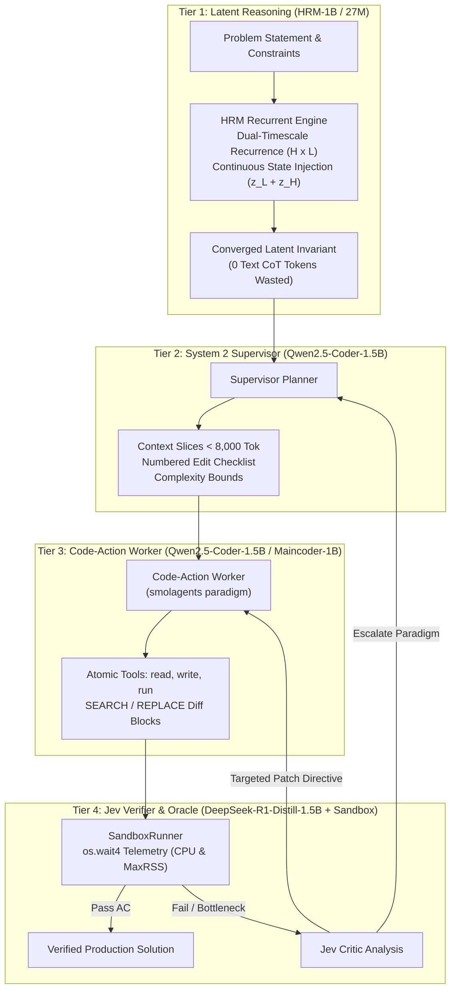

# HRM-4M Architecture & Technical Specification

The **Hierarchical Reasoning Model (HRM-4M)** is an autonomous coding agent framework engineered for resource-constrained hardware (consumer laptop GPUs with $\le 6$ GB VRAM). It overcomes the historical "intelligence ceiling" of sub-2B models by replacing discrete textual Chain-of-Thought (CoT) token generation with **continuous latent-space recurrence** and enforcing a strict **four-tier collaborative division of labor**.

---

## 1. Architectural Overview

Traditional LLMs reason via discrete, irreversible text tokens. If an algorithmic mistake is made early in the generation, the remaining text compounds the failure or degrades into verbose backtracking. HRM-4M resolves this by decoupling mathematical/algorithmic invariant discovery from instruction-following and code generation.

---

## 2. The Four Tiers Explained

### Tier 1: HRM Latent Reasoner (Model 1)
- **Role**: Mathematical, algorithmic, and invariant solver.
- **Engine**: Dual-timescale continuous recurrence engine ($H \times L$) based on Sapient HRM.
- **Mechanism**:
  - **Module $H$ (Macro-Planner)**: Slow-clock recurrence ($\tau_H$) managing high-level goals, asymptotic bounds, and invariant conservation.
  - **Module $L$ (State Explorer)**: Fast-clock recurrence ($\tau_L$) exploring local state transitions, base cases, and boundary permutations.
  - **Additive State Injection**: $(z_L + z_H + \text{embedding})$ iterates across $H_{\text{cycles}} \times L_{\text{cycles}}$ steps entirely in continuous latent manifold.
  - **ACT Halting Head**: Halting probability $Q(\text{halt} \mid \bar{z}_H)$ terminates recurrence dynamically when confidence exceeds threshold $\theta = 0.85$, eliminating redundant forward computation.
- **Output**: High-dimensional concept representation and concise algorithmic invariant without discrete token waste.

### Tier 2: Supervisor / Architect Planner (Model 2)
- **Role**: System 2 macro-planner and context governor.
- **Base Model**: `Qwen2.5-Coder-1.5B-Instruct` / `DeepSeek-R1-Distill-Qwen-1.5B`.
- **Mechanism**:
  - Consumes the converged latent invariant and user specifications.
  - Enforces **Context Slicing ($< 8,000$ tokens)**: Isolates exact target functions, imports, and data models rather than dumping whole multi-file trees.
  - Emits a structured architectural blueprint with time/space complexity bounds, data structure selections, and a numbered edit checklist.
  - Formulates the standard I/O driver framing to prevent sub-1B runtime dropouts (`RE`).

### Tier 3: Code-Action Worker (Model 3)
- **Role**: System 1 fast worker and syntactic translator.
- **Base Model**: `Qwen2.5-Coder-1.5B-Instruct` (default worker) or `Qwen3.5-0.8B` (linear attention).
- **Mechanism**:
  - **Code-Action Paradigm (`smolagents` style)**: Rather than generating nested JSON tool calls (where small models frequently produce quote escaping and schema errors), the worker writes concise Python snippets invoking atomic tools directly.
  - **Atomic Tools**:
    - `read_file(path: str)`: Reads target file contents within workspace.
    - `write_file(path: str, content: str)`: Writes content, creating parent directories safely.
    - `run_command(cmd: str, timeout_sec: float)`: Runs shell command inside workspace with process-group timeout isolation (`start_new_session=True`, `SIGKILL` on timeout).
    - `apply_diff(path: str, diff_text: str)`: Applies surgical literal `SEARCH / REPLACE` diff blocks.
  - **SEARCH / REPLACE Diff Application**: Bypasses unified diff hunk math (`@@ -line,col @@`), eliminating line-number calculation errors.

### Tier 4: Jev Verifier & Critic (Model 4)
- **Role**: Sandboxed execution, telemetry monitoring, and closed-loop self-repair.
- **Engine**: `SandboxRunner` with `os.wait4` kernel telemetry.
- **Mechanism**:
  - Executes candidate code inside isolated temporary scratch workspaces.
  - Measures microsecond CPU time (`ru_utime`, `ru_stime`) and peak resident memory (`ru_maxrss`).
  - Verifies sample outputs and custom checker scripts.
  - On failure (`WA`, `RE`, `TLE`, `MLE`), diagnoses the exact bottleneck class (`asymptotic_time`, `constant_factor`, `integer_overflow`, `edge_case_miss`) and emits targeted patch directives back to Model 3.

---

## 3. Hardware Footprint & Optimization Guidelines

The complete four-tier architecture runs resident on consumer laptop hardware (e.g., NVIDIA GeForce RTX 4050 with 6 GB VRAM):

| Component | VRAM Footprint | Quantization / Precision | Optimization |
| :--- | :--- | :--- | :--- |
| **HRM Latent Reasoner** | ~120 MB | `bfloat16` / FP32 | Continuous latent state caching |
| **Role 1 (Architect / Critic)** | ~980 MB | `bfloat16` / Q8_0 | Liger chunked cross-entropy |
| **Role 2 (Coder / Patcher)** | ~905 MB | `bfloat16` / Q8_0 | FlashAttention-2 / SDPA |
| **Total Resident Footprint** | **~2,005 MB (~1.96 GB)** | — | **32.7% of 6,141 MiB VRAM** |
| **Peak During Generation** | **~2,097 MB (~2.05 GB)** | — | Fits with 4.0 GB VRAM headroom |

### Recommended Rules for $\le 1.5$B Deployments
1. **Pass File Slices, Not Whole Repos**: Small models degrade once prompts exceed ~8,000 tokens. Always slice context down to the immediate file/function.
2. **Use Q8_0 or bfloat16**: At 1.5B parameters, 4-bit quantization noticeably degrades Kotlin generics and TypeScript typing. Q8_0 preserves high syntactic fidelity in <2 GB RAM.
3. **Cap Thinking Mode**: When using reasoning workers (e.g. DeepSeek-R1-Distill-1.5B), cap `<think>` tags between 512 and 1,024 tokens to prevent infinite loops.
4. **Use Code-Actions over JSON Schemas**: Sub-1B models make virtually zero syntax errors writing `read_file("foo.py")`, but frequently fail on deeply nested JSON schemas.
